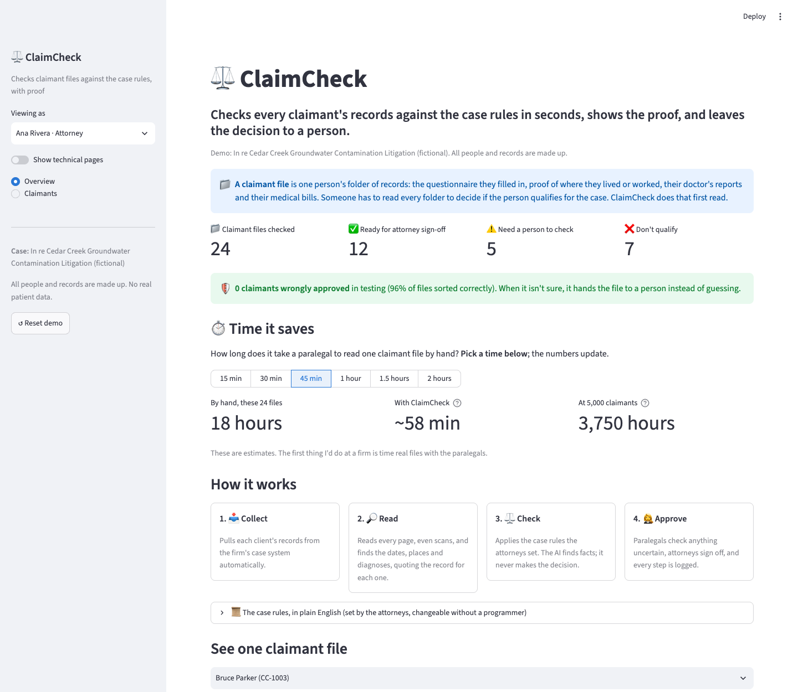
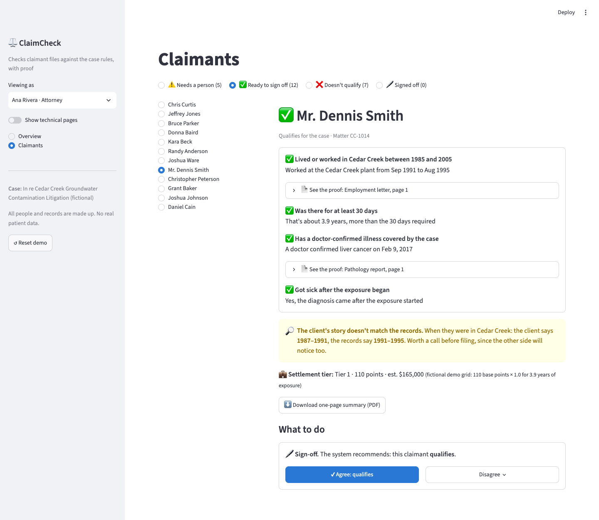
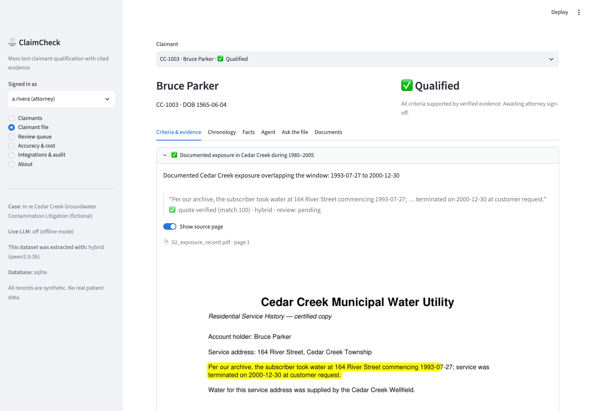
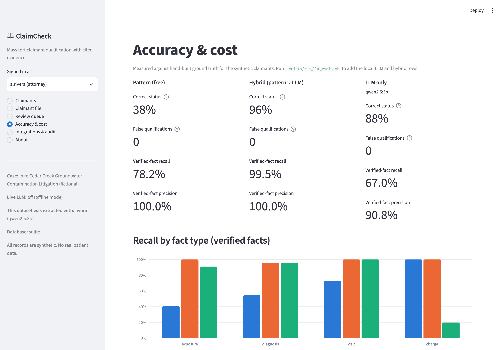
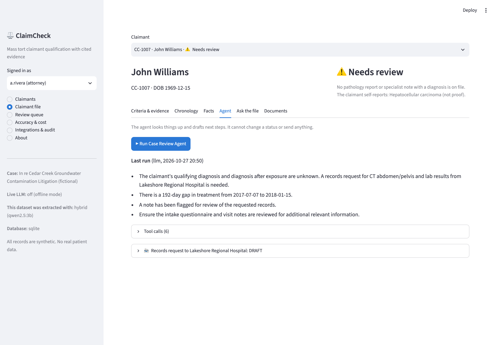

# ClaimCheck

**AI-assisted claimant qualification for mass tort firms, with cited evidence.**

In an environmental mass tort, a plaintiff firm has to check thousands of claimants' records against the case
criteria: *documented exposure, in the right place and period, long enough, then a qualifying diagnosis made by a
doctor.* ClaimCheck does the first pass. It extracts the facts with citations you can verify, applies the criteria,
sends anything uncertain to a paralegal, and drafts the follow-up work. Attorneys make every decision.

> All data is synthetic, and the litigation ("In re Cedar Creek Groundwater Contamination") is fictional.



<details><summary>Claimants workspace: plain-English checks, proof, and one-click actions</summary>


</details>

<details><summary>Technical view: claimant file with highlighted evidence</summary>


</details>

## What it does

| | |
|---|---|
| **Intake** | Pulls matters and documents from the firm's case management system (mock CMS with a REST API), API upload, or a watched folder. OCR for scanned pages (Tesseract). |
| **Extraction (LLM)** | Hybrid: a free pattern extractor reads known layouts, and a local LLM (Ollama, `qwen2.5:3b`) reads the pages it can't. Any OpenAI-compatible API works too. |
| **Verification** | Every fact must quote the record. Code checks that the quote is really on the cited page **and** that the dates, ICD-10 codes and amounts are in that quote. Unverified facts never count as proof. |
| **Criteria engine** | Deterministic rules from `cases/cedar_creek.yaml` decide *qualified / not qualified / needs review*, and link each criterion to its evidence. The LLM never decides. |
| **Case Review Agent** | Tool-calling agent: searches the file, flags facts to check, finds gaps in treatment, and **drafts** records requests limited to an approved list of record types, with HIPAA authorization wording. It can't change a status or send anything. Offline planner when no LLM is available. |
| **Human review** | Paralegals approve/reject facts. Attorneys sign off on claimants (overriding the system requires a written reason) and approve records requests. |
| **Inconsistency detection** | Compares what the client said on the intake form with what the records show (dates in Cedar Creek, illness, diagnosis year) and flags mismatches before the other side finds them. |
| **Case-team views** | Missing-records tracker across all claimants, settlement tier and value under the case's grid (the demo grid is fictional), one-page claimant summary PDF, and a claimant spreadsheet export for courts and funders. |
| **Audit & governance** | Tamper-evident audit log (each entry hash-chained to the previous one), role-based permissions, per-call LLM token/latency/cost logging, accuracy measured against ground truth. |
| **API & integrations** | FastAPI with OpenAPI docs, CMS pull/push client, HMAC-signed webhooks, folder intake. |
| **Data** | PostgreSQL + pgvector (vectors in the same database as the facts) or SQLite for zero-setup runs. |

## Results

24 synthetic claimants, 173 PDFs (30% written in layouts the pattern extractor was never built for, some scanned),
scored against ground truth by `claimcheck/evaluate.py`. Local model: `qwen2.5:3b` on an 8 GB MacBook.

| | Pattern only (free) | **Hybrid (pattern → LLM)** | LLM only |
|---|---|---|---|
| Correct qualification status | 38% (9/24) | **96% (23/24)** | 88% (21/24) |
| False qualifications (the costly error) | 0 | **0** | 0 |
| Verified-fact recall | 78.2% | **99.5%** | 67.0% |
| Verified-fact precision | 100% | **100%** | 90.8%¹ |
| Intake-vs-records inconsistencies found | 3 of 6 | **6 of 6, 0 false alarms** | 5 of 6 |
| LLM calls | 0 | **45** | 173 |
| LLM time per claimant | 0 s | **7 s** | 42 s |
| API cost | $0 | **$0 (local)** | $0 (local) |
| Same tokens on a paid API² | — | **$0.0003 / claimant** | $0.0012 / claimant |

**How to read this:**
- **Nothing is ever falsely qualified.** When a method can't read a record, the claimant goes to *needs review*.
  That's why the pattern extractor's 38% is safe, just slow for the reviewers.
- **Hybrid is the most accurate *and* the cheapest LLM option.** It only sends the ~1 in 3 pages the free extractor
  can't read to the model. Running the LLM on everything was less accurate: the 3B model handles invoice tables worse
  than a regex does.
- The one hybrid miss (CC-1015) is an OCR error: the scan turned ICD code "I10" into "110". The format check refuses
  the garbled code, so the claimant goes to a person instead of being decided.

¹ Mostly bill lines like "Office visit, $198.78" labelled as *visits* rather than *charges*: real dates and real quotes,
debatable category. ² At a reference price of $0.15 / $0.60 per 1M input/output tokens (configurable in `.env`).

<p align="center"> </p>

## Quick start

```bash
python -m venv .venv && source .venv/bin/activate
pip install -r requirements.txt
brew install tesseract               # optional, for scanned pages (apt: tesseract-ocr)

python -m claimcheck.pipeline demo   # synthetic claimants → CMS pull → extract → qualify → agent → eval (~5 s, offline)
streamlit run app.py                 # dashboard at http://localhost:8501
uvicorn claimcheck.api:app           # REST API, docs at http://localhost:8000/docs
```

**With a free local LLM:**

```bash
ollama pull qwen2.5:3b
export LLM_BASE_URL=http://localhost:11434/v1
python -m claimcheck.pipeline demo --keep-data --method hybrid
scripts/run_llm_evals.sh             # hybrid and LLM-only evaluations, each in its own database
```

**Everything with Postgres + pgvector:** `docker compose up --build` (API :8000, dashboard :8501, mock CMS :8001).

**Tests:** `python -m pytest -q` runs offline. CI runs the same suite on SQLite and on Postgres + pgvector.

**Hosted demo (free):** push to GitHub, then deploy `app.py` on [Streamlit Community Cloud](https://share.streamlit.io).
It loads `demo_bundle/` (a precomputed hybrid-LLM run), so no model or database server is needed. `packages.txt` installs Tesseract.

## Try the API

```bash
curl -s localhost:8000/claimants -H "X-User: j.chen" | head
curl -s localhost:8000/claimants/1/qualification -H "X-User: j.chen"
curl -s -X POST localhost:8000/claimants/1/decision -H "X-User: j.chen" \
     -H "Content-Type: application/json" -d '{"decision":"qualified"}'      # 403: paralegals can't decide
```

## Project layout

```
claimcheck/
  synth.py         synthetic claimant PDFs + ground truth (messy layouts, scans, edge-case scenarios)
  ingest.py        PDF → pages (OCR fallback) → document type → chunks + embeddings
  extract.py       pattern / LLM / hybrid extraction, quote + value verification, evidence locator
  rules.py         case criteria engine (YAML) → pass / fail / unknown per criterion
  insights.py      inconsistencies, missing records, settlement valuation, census export, summary PDF
  plain.py         plain-English explanations for non-technical users
  agent.py         Case Review Agent: tools, guardrails, LLM and offline planners
  search.py        claimant-scoped retrieval (pgvector or numpy), chronology, treatment gaps, cited Q&A
  service.py       operations with role checks + audit (shared by API and dashboard)
  api.py           FastAPI app
  evaluate.py      precision/recall per fact type, status accuracy, false qualifications, cost
  integrations/    cms.py (client), mock_cms.py (stand-in firm CMS), webhooks.py (signed)
  db.py            SQLAlchemy models (SQLite or Postgres + pgvector)
cases/             case criteria as YAML
app.py             Streamlit dashboard
docs/              architecture, build-vs-buy memo, how AI-assisted development was used
```

## Docs

- [Architecture and key decisions](docs/architecture.md)
- [Build vs. buy memo](docs/build_vs_buy.md)
- [How I used AI to build this](docs/ai_assisted_development.md)

## Limitations

- Synthetic records are cleaner and more uniform than real ones. Real deployment needs an evaluation on a labelled
  sample of the firm's own, already-decided files.
- A 3B local model is fast and private but weaker than hosted frontier models, especially as an agent: it often stopped
  without acting or summarising. `AGENT_MODEL` can point the agent at a larger model (the bundled CC-1007 run used
  `qwen2.5:7b-instruct`, ~7 min on 8 GB); the other bundled runs used the offline planner. Every agent output is a
  draft and every fact is verified.
- The mock CMS has no pagination, rate limits or incremental sync; a real connector would add them.
- Demo authentication is a header with a fixed user directory; production would use SSO.
